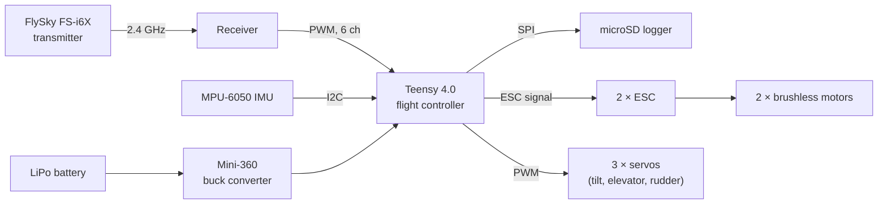

# Fixed-Wing Tilt-Rotor VTOL UAV

**Design, CFD-driven optimisation and flight-control development of a low-cost, 3D-printed tilt-rotor VTOL UAV.**


## Overview

Fixed-wing aircraft are efficient but need a runway; multirotors take off vertically but are energy-hungry in cruise. This project develops a **hybrid tilt-rotor fixed-wing UAV** that combines vertical take-off and landing (VTOL) with efficient wing-borne flight, using only two tilting motors and a glider-style airframe. The target applications are surveillance, medical and cargo delivery, and precision agriculture.

The work covers the whole development chain: analytical sizing, airfoil selection, 2D and 3D aerodynamic analysis, CAD and tilt-mechanism design, fabrication from 3D-printed PLA and carbon-fibre tubes, a custom Teensy-based flight-controller PCB, and attitude-stabilisation firmware.

It was carried out as a B.Sc. thesis in Mechanical Engineering at Ahsanullah University of Science and Technology (AUST), Dhaka, and the control-system part was published at IEEE ECCE 2025 (see [Publications](#publications-and-citation)).

## Key contributions

- **End-to-end design workflow** from requirements and analytical sizing to CFD-based optimisation, CAD, fabrication and electronics integration.
- **Validated 2D aerodynamics:** XFLR5 lift and drag coefficients for the NACA 4412 airfoil compared against published experimental data (Miley, 1982, Re = 330,000) and open airfoil databases.
- **Wing optimisation by 3D CFD:** a tapered wing was redesigned as a constant-chord wing (0.2 m), giving about 30 % more lift at the same flight condition, cross-checked between ANSYS and XFLR5.
- **Propulsion trade-off found in hardware:** the initially selected high-thrust motors overloaded the 3D-printed PLA mounts, so lower-thrust motors were adopted. This is documented as a design lesson in the thesis.
- **Custom flight controller:** two PCB revisions around a Teensy 4.0, an MPU-6050 IMU and a microSD data logger, running firmware adapted from the open-source dRehmFlight project for this two-motor, three-servo airframe.
- **Sustainability assessment:** life-cycle analysis of the airframe and a mapping of the project to UN Sustainable Development Goals.

## Specifications

| Item | Value |
|---|---|
| Configuration | Fixed-wing, twin tilt-rotor, glider-style airframe |
| Airfoil | NACA 4412 |
| Wingspan / chord (optimised wing) | 1.2 m / 0.2 m (constant chord) |
| Fuselage (L × W × H) | 0.4 m × 0.2 m × 0.08 m |
| Tail | 0.7 m carbon-fibre tail tube, 0.15 m elevator on each side |
| Design gross weight / payload | 2 kg / 0.5 kg |
| Measured weight with electronics | 1450 g (thesis Table 6.1) |
| Design cruise / maximum speed | 10 m/s / 30 m/s |
| Propulsion | 2 × EMAX 980 KV outrunner, 12×6 carbon-fibre propellers, BLHeli 50 A ESCs |
| Structure | FDM 3D-printed PLA, carbon-fibre tubes, epoxy and carbon cloth |
| Flight computer | Teensy 4.0 (600 MHz ARM Cortex-M7) |
| IMU / logging | MPU-6050 (6-DOF) / microSD module over SPI |
| Radio | FlySky FS-i6X, 2.4 GHz, 6 channels |

## Methodology


## Aerodynamic analysis and results

**CFD setup (3D).** ANSYS Workbench, SST k-ω turbulence model, pressure-velocity coupled scheme with second-order discretisation, inlet velocity 10 m/s and 10° angle of attack. Mesh: 150 mm base size, 42 mm body sizing, 10 mm face sizing, 12 inflation layers (16 mm maximum thickness).

**Validation.** XFLR5 results for the NACA 4412 show strong agreement with published experimental data at low angles of attack, with small differences at higher angles. Wind-tunnel testing was not feasible for this project.

**Lift and drag of the airfoil-based wing model at 10° angle of attack** (XFLR5 2D coefficients scaled to the wing):

| Velocity (m/s) | Reynolds number | C<sub>L</sub> | Lift (N) | C<sub>D</sub> | Drag (N) |
|---:|---:|---:|---:|---:|---:|
| 5 | 28,063 | 0.670 | 1.47 | 0.1252 | 0.27 |
| 10 | 56,127 | 1.367 | 12.05 | 0.0380 | 0.33 |
| 15 | 84,190 | 1.372 | 27.2 | 0.0287 | 0.57 |
| 20 | 112,254 | 1.373 | 48.4 | 0.0255 | 0.90 |
| 25 | 140,317 | 1.373 | 75.6 | 0.0239 | 1.31 |
| 30 | 168,381 | 1.372 | 108.9 | 0.0230 | 1.82 |

**Optimised wing (constant chord 0.2 m), 10 m/s, 10° angle of attack:**

| Method | Lift (N) | Drag (N) |
|---|---:|---:|
| ANSYS 3D CFD | 13.36 | 1.13 |
| XFLR5 | 15.61 | not reported |

The difference between the two tools is expected: ANSYS resolves the full 3D flow with a refined mesh, while XFLR5 is a panel method that approximates the flow and can under-predict 3D effects.

## Hardware and electronics



The thesis documents two flight-controller PCB revisions (board size 90 mm × 105 mm) that keep the same Teensy 4.0, IMU and microSD module and leave room for additional sensors.

## Flight-control firmware

The firmware is in [`firmware/vtol_flight_controller`](firmware/vtol_flight_controller/vtol_flight_controller.ino) and runs on a Teensy 4.0. It is adapted from [dRehmFlight](https://github.com/nickrehm/dRehmFlight) by Nicholas Rehm (GPL-3.0) for a two-motor, three-servo configuration.

**What it does**

- Reads an MPU-6050 over I2C, applies low-pass filtering and estimates attitude with a Madgwick filter.
- Angle-mode stabilisation: roll and pitch angle control with gyro-rate damping, and yaw-rate control. A cascaded angle/rate controller (`controlANGLE2`, `controlRATE`) is also included.
- Decodes six PWM receiver channels with interrupts (a PPM option is also in the code).
- Mixes the controller outputs onto two motors using OneShot125 signalling.
- Arming, throttle cut and receiver failsafe, running at a 2 kHz loop rate.
- Includes an IMU calibration routine (`calculate_IMU_error()`) that prints offsets to paste into the firmware.

**Default settings in the released code** (these match the dRehmFlight defaults)

| Axis | Kp | Ki | Kd | Limit |
|---|---:|---:|---:|---|
| Roll angle | 0.2 | 0.3 | 0.05 | ±30° |
| Pitch angle | 0.2 | 0.3 | 0.05 | ±30° |
| Yaw rate | 0.3 | 0.05 | 0.00015 | ±160 °/s |

**Pin map**

| Function | Teensy pin |
|---|---|
| Receiver channels 1–6 | 15, 16, 17, 20, 21, 22 |
| Motors 1 and 2 | 0, 1 |
| Servos 1–3 | 6, 7, 8 |
| Status LED | 13 |

**Build and flash**

1. Install the [Arduino IDE](https://www.arduino.cc/en/software) and the [Teensyduino](https://www.pjrc.com/teensy/td_download.html) add-on.
2. Install the MPU6050 library (I2Cdevlib) through the Library Manager. `PWMServo` is included with Teensyduino.
3. Open `vtol_flight_controller.ino`, select **Teensy 4.0**, and upload.
4. With the propellers removed, open the Serial Monitor (500000 baud) and check the receiver channels. To calibrate the IMU, call `calculate_IMU_error()` once from `setup()`, then paste the printed offsets into the variables at the top of the file.

> **Safety:** always remove the propellers for bench tests. Channel 5 is the arming and throttle-cut switch.

## Project status and limitations

- A prototype was fabricated and the electronics were integrated and calibrated on the bench. **Full flight testing was not completed** because of manufacturing difficulties during the early stages (thesis, Section 9.2).
- The current firmware is for manual RC flight. **Tilt-angle scheduling and the hover-to-cruise transition are not implemented yet**, and the tilt-servo outputs are fixed in `controlMixer()`.
- 3D CFD was run at a single speed and angle of attack. Results were cross-checked between two tools but not against wind-tunnel data.

**Planned work:** transient CFD with advanced turbulence models across tilt angles and transition, dynamic system modelling and hardware-in-the-loop testing, synchronised tilt control, lighter composite structures, and autonomous flight.

## Sustainability assessment

A life-cycle assessment of the airframe was run with SolidWorks Sustainability. For one wing half, the estimate is 1.7 kg CO₂e and 30 MJ of energy, and for a 750 mm carbon-fibre tube 1.4 kg CO₂e and 25 MJ. The thesis relates the project to SDG 7 (affordable and clean energy), SDG 9 (industry, innovation and infrastructure), SDG 11 (sustainable cities and communities), SDG 13 (climate action) and SDG 17 (partnerships for the goals).

## Publications and citation

**Conference paper**

M. Harun-Or-Rashid, D. M. Eshak, A. K. Shuvo, L. R. Turjo, O. S. Thinan and M. S. Durjoy, "Control System Design of a Fixed wing VTOL UAV," *2025 International Conference on Electrical, Computer and Communication Engineering (ECCE)*, CUET, Chattogram, Bangladesh, 13–15 Feb 2025. DOI: [10.1109/ECCE64574.2025.11013869](https://doi.org/10.1109/ECCE64574.2025.11013869)

```bibtex
@inproceedings{harunorrashid2025vtol,
  author    = {Harun-Or-Rashid, Mohammed and Eshak, Dewan Mohammed and Shuvo, Ahsanul Kabir and Turjo, Laisur Rahman and Thinan, Omon Sharker and Durjoy, Md. Shahjahan},
  title     = {Control System Design of a Fixed wing {VTOL} {UAV}},
  booktitle = {2025 International Conference on Electrical, Computer and Communication Engineering (ECCE)},
  year      = {2025},
  address   = {Chattogram, Bangladesh},
  doi       = {10.1109/ECCE64574.2025.11013869}
}
```

**B.Sc. thesis**

D. M. Eshak, A. K. Shuvo and L. R. Turjo, "Design & Development of a Fixed Wing VTOL UAV with Tilt-Rotors," B.Sc. thesis, Department of Mechanical and Production Engineering, Ahsanullah University of Science and Technology, Dhaka, June 2025. Supervisor: Dr. Mohammad Harun-Or-Rashid.

## Repository structure

```text
.
├── LICENSE
├── README.md
└── firmware/
    └── vtol_flight_controller/
        └── vtol_flight_controller.ino
```

## Team

Department of Mechanical and Production Engineering, Ahsanullah University of Science and Technology (AUST), Dhaka-1208, Bangladesh.

- Ahsanul Kabir Shuvo (repository maintainer)
- Dewan Mohammed Eshak
- Laisur Rahman Turjo
- Omon Sharker Thinan and Md. Shahjahan Durjoy (conference-paper co-authors)
- Supervisor: Dr. Mohammad Harun-Or-Rashid, Associate Professor

## Acknowledgements

Thanks to Dr. Mohammad Harun-Or-Rashid for supervision and to Omon Sharker Thinan for advice on CAD system design. The flight-controller firmware is adapted from the open-source [dRehmFlight](https://github.com/nickrehm/dRehmFlight) project by Nicholas Rehm.

## License

Released under the [GNU General Public License v3.0](LICENSE). The firmware is derived from dRehmFlight, which uses the same license.
